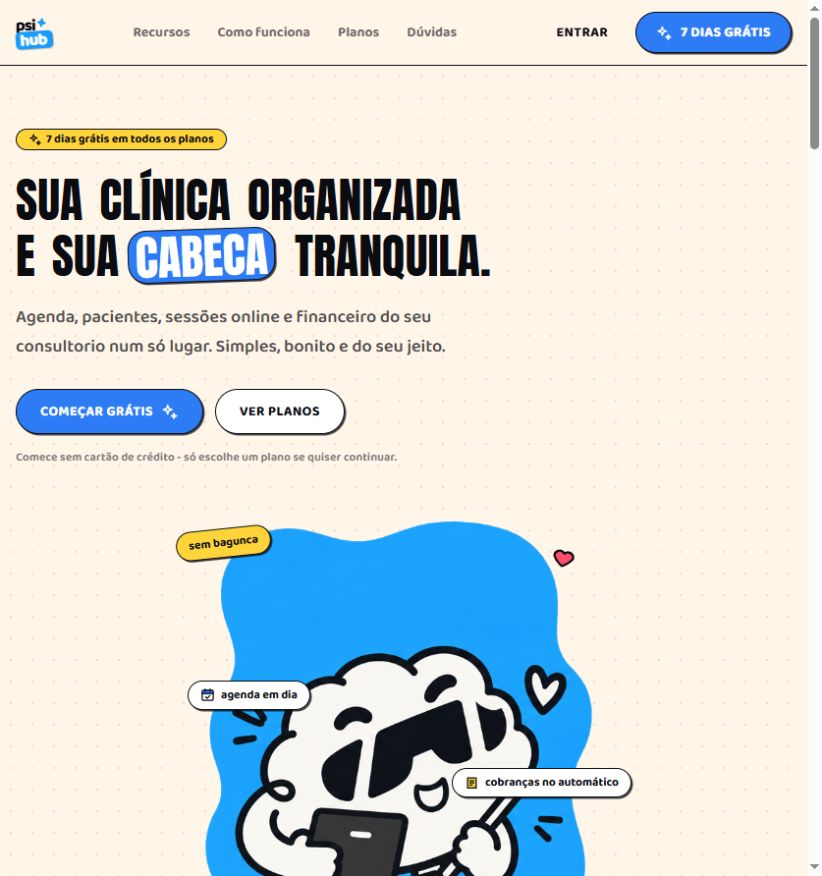
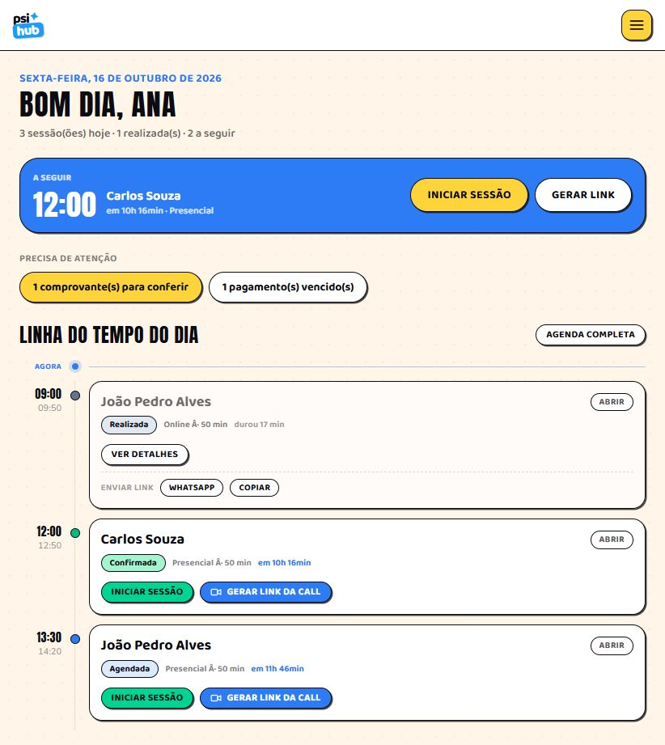
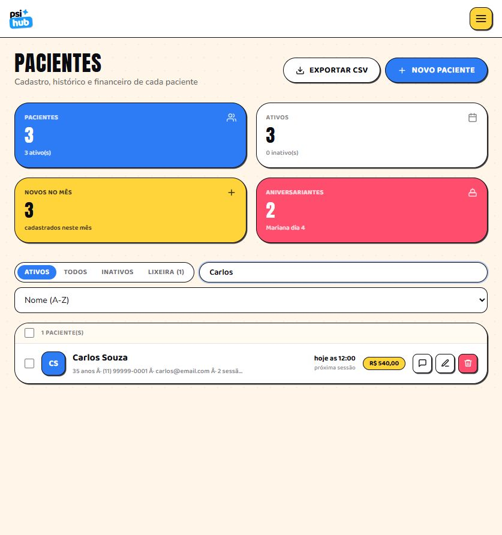
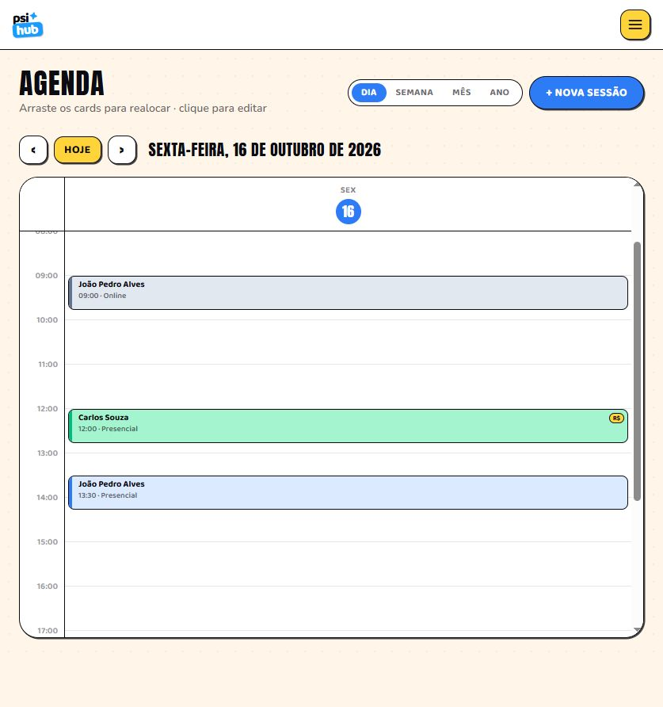
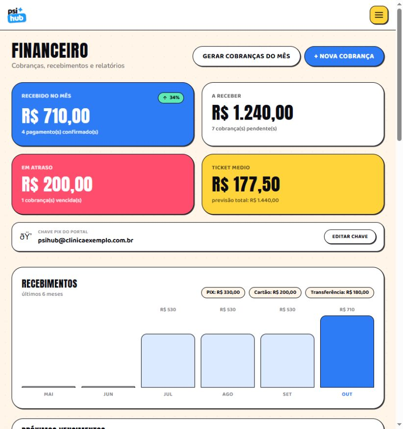

# Psi Hub by slooti

Sistema web de gestão de consultórios de psicologia, com painel da clínica e portal do paciente. Reúne cadastro de pacientes, agenda, sessões online, cobranças, recados e compartilhamento de documentos. Interface responsiva em português, com identidade visual de adesivos e suporte a instalação como PWA.

## Prints do sistema

Capturas reais da aplicação local, com a clínica e os pacientes de demonstração. A interface se adapta à largura da tela.

### Página de apresentação


### Painel da clínica


### Cadastro de pacientes


### Agenda


### Financeiro


## O que o projeto faz

### Conta e clínica

O cadastro cria uma clínica e seu usuário administrador. O login retorna um token JWT usado nas chamadas autenticadas. Os registros são associados à clínica por `clinicId`. O modelo prevê os papéis ADMIN, PSYCHOLOGIST e SECRETARY; isso não representa uma matriz completa de permissões implementada para cada papel.

### Dashboard

Mostra as sessões do dia, a próxima consulta, uma linha do tempo e pendências que precisam de atenção. Permite iniciar e finalizar sessões, acompanhar o tempo de atendimento e acessar os agendamentos.

### Pacientes

- Cadastro de nome, e-mail, telefone, CPF, nascimento, endereço, contato de emergência, origem do contato e valor padrão da sessão.
- Busca, ordenação, filtros por situação, indicadores, seleção em lote e exportação CSV.
- Perfil com histórico e próximas sessões, valores em aberto, indicadores financeiros e anotações internas.
- Ativação/inativação, exclusão lógica, lixeira e restauração; há também exclusão definitiva.
- Registro de consentimento e exportação dos dados do paciente. Esses recursos, isoladamente, não certificam conformidade com a LGPD.

### Agenda e sessões online

Visualizações por dia, semana, mês e ano. É possível criar, editar, excluir e remarcar sessões arrastando, inclusive arrastar um paciente para a agenda. Sessões simultâneas são distribuídas lado a lado. O sistema registra modalidade, status, confirmação, início e fim do atendimento.

O link de videochamada pode ser gerado para uma sala Jitsi ou informado manualmente, como um link do Google Meet. A chamada acontece no serviço externo. Compartilhamentos por WhatsApp e e-mail abrem links para o usuário enviar a mensagem; não são disparos automáticos por uma API de mensageria.

### Financeiro

Cadastro e edição de cobranças, baixa de pagamentos, estorno da baixa, identificação de vencimentos, recibos para impressão, indicadores, gráfico mensal e ranking de pacientes. Registra PIX, dinheiro, cartão ou transferência como forma de pagamento.

A geração de cobranças mensais é acionada pelo usuário e usa o valor padrão dos pacientes ativos. Não há agendador de cobrança, processamento bancário ou conciliação automática. A chave PIX no portal é informativa e os comprovantes são conferidos pela clínica.

### Portal do paciente

A clínica libera o acesso na aba Portal do perfil do paciente. O paciente usa `/portal/login` para criar sua primeira senha ou entrar. A clínica pode bloquear o acesso, gerar uma senha temporária ou reiniciar o primeiro acesso.

O portal oferece:

- Resumo e lista de sessões, confirmação de presença e acesso ao link de uma sessão online disponível.
- Cobranças, histórico financeiro, chave PIX da clínica e envio de comprovantes.
- Troca de recados entre paciente e clínica.
- Download de documentos compartilhados pelo profissional.
- Materiais recomendados por links e tarefas entre sessões, com marcação de conclusão.
- Atualização de telefone e e-mail.

A clínica administra recados, documentos, materiais, tarefas e comprovantes pelo perfil do paciente. Arquivos são enviados em base64 e armazenados como BLOB no banco, com limite de 3 MB por arquivo; o servidor aceita corpos de requisição de aproximadamente 4,4 MiB.

### Páginas públicas e PWA

`/landing` e `/landing2` apresentam duas versões da vitrine do produto. Os planos e o período grátis exibidos são conteúdo comercial da interface: este código não implementa assinatura, checkout ou controle de expiração do teste.

A PWA inclui manifesto, ícone e service worker. O cache cobre a estrutura estática do aplicativo; os dados e as operações da API dependem de conexão. Não há sincronização de alterações offline.

## Tecnologias

| Camada | Tecnologias |
| --- | --- |
| Organização | npm workspaces, TypeScript |
| Interface | React 19, Vite 8, Tailwind CSS 4 |
| Navegação e dados | React Router, TanStack Query |
| API | Fastify 5, Zod |
| Autenticação | JWT e bcrypt |
| Persistência | Prisma 6 e SQLite |
| PWA | vite-plugin-pwa |

## Executar localmente

Use Node.js compatível com o Vite 8: 20.19+ ou 22.12+ (recomendado 22.12+), e npm.

```bash
git clone https://github.com/vitorhugomachado/PsiHubByslooti.git
cd PsiHubByslooti
npm ci
```

Copie `apps/api/.env.example` para `apps/api/.env`. No PowerShell:

```powershell
Copy-Item apps/api/.env.example apps/api/.env
```

Configure o ambiente no terminal que iniciará a API, pois o servidor não carrega `.env` explicitamente. O CLI do Prisma lê o arquivo para os comandos do banco. No PowerShell:

```powershell
$env:DATABASE_URL = 'file:./dev.db'
$env:JWT_SECRET = 'substitua-por-um-segredo-longo-aleatorio'
$env:PORT = '3000'
npm run db:push
npm run db:seed
npm run dev
```

Em bash, use `export DATABASE_URL='file:./dev.db'`, `export JWT_SECRET='seu-segredo'` e `export PORT=3000` antes dos mesmos comandos npm.

- Aplicação: http://localhost:5173
- Saúde da API: http://localhost:3000/api/health
- Portal: http://localhost:5173/portal/login
- Demonstração criada pelo seed: `admin@psigest.com` / `123456`.

O seed cria uma clínica, um administrador, três pacientes, sessões e cobranças fictícias. Se o administrador já existir, ele não recria os dados. O acesso ao portal deve ser liberado pela clínica; o seed não cria uma senha de paciente.

Não use as credenciais de demonstração em um ambiente real. O banco local, os arquivos `.env`, as dependências e os artefatos gerados não são versionados.

## Comandos

| Comando | Função |
| --- | --- |
| `npm run dev` | Inicia API e frontend juntos |
| `npm run dev:api` | Inicia API com recarga durante desenvolvimento |
| `npm run dev:web` | Inicia Vite na porta 5173 |
| `npm run db:push` | Aplica o schema e gera Prisma Client |
| `npm run db:seed` | Insere os dados de demonstração |
| `npm run setup` | Executa instalação, db:push e seed; requer ambiente configurado |
| `npm run build` | Compila o frontend e gera a PWA em apps/web/dist |
| `npm run typecheck --workspaces --if-present` | Verifica TypeScript na API e no frontend |
| `npm run start -w @psigest/api` | Inicia API via tsx, sem modo watch |
| `npm run db:studio -w @psigest/api` | Abre Prisma Studio |

No Windows, pare a API antes de regenerar o Prisma Client caso o motor esteja bloqueado pelo processo em execução.

## Estrutura e responsabilidades

```text
apps/
  api/
    .env.example            Exemplo público de configuração
    prisma/schema.prisma    Modelos e relações do banco
    src/server.ts           Fastify, CORS, JWT e registro de rotas
    src/seed.ts             Dados fictícios para desenvolvimento
    src/lib/                Prisma, autenticação e funções de segurança
    src/routes/             Regras e endpoints por domínio
  web/
    public/                 Ícone e imagens do mascote
    src/App.tsx             Rotas públicas, da clínica e do portal
    src/pages/              Telas da aplicação
    src/pages/portal/       Telas do paciente
    src/components/        Layout e componentes reutilizáveis
    src/lib/               Cliente HTTP, autenticação e utilitários
    src/index.css          Estilos e tokens visuais
    src/types.ts           Tipos compartilhados pela interface
docs/screenshots/          Capturas utilizadas neste README
```

O navegador chama `/api`, e o proxy de desenvolvimento do Vite encaminha para a API na porta 3000 preservando esse prefixo. O backend valida entradas com Zod e acessa o SQLite pelo Prisma. Em produção, é necessário configurar o encaminhamento de `/api` e o fallback das rotas do frontend no servidor de hospedagem.

O banco contém Clinic, User, Patient, Appointment e Payment, além de Message, Document, Material, Task e Proof para o portal. O cliente Prisma é gerado em `apps/api/src/generated/prisma` e não faz parte do Git.

## API

Rotas abaixo são relativas a `http://localhost:3000/api`. As rotas privadas exigem `Authorization: Bearer <token>`; o portal usa token de paciente separado do acesso da clínica.

| Grupo | Endpoints e responsabilidade |
| --- | --- |
| Saúde | `GET /health` |
| Conta | `POST /auth/register`, `POST /auth/login`, `GET /auth/me` |
| Pacientes | `GET/POST /patients`, `GET /patients/stats`, `GET/PUT/DELETE /patients/:id`, `POST /patients/:id/status`, `POST /patients/:id/restore` |
| Agenda | `GET/POST /appointments`, `PUT/DELETE /appointments/:id`, `POST /appointments/:id/meet`, `/start`, `/finish` |
| Financeiro | `GET/POST /payments`, `GET /payments/summary`, `POST /payments/generate-monthly`, `PUT/DELETE /payments/:id`, `POST /payments/:id/pay`, `/unpay` |
| Painel | `GET /dashboard/summary` |
| Acesso do paciente | `POST /portal/register`, `POST /portal/login`, `GET /portal/me` |
| Sessões do portal | `GET /portal/overview`, `GET /portal/appointments`, `POST /portal/appointments/:id/confirm` |
| Financeiro do portal | `GET /portal/payments`, `GET/POST /portal/proofs` |
| Recados | `GET/POST /portal/messages` |
| Conteúdo do portal | `GET /portal/documents`, `GET /portal/documents/:id/file`, `GET /portal/materials`, `GET /portal/tasks`, `POST /portal/tasks/:id/toggle` |
| Contato | `PUT /portal/contact` |
| Administração | `GET /portal-admin/summary`, `GET/PUT /portal-admin/pix`, `GET /portal-admin/patients/:id` |
| Acesso administrado | `POST /portal-admin/patients/:id/access`, `/password`, `/reset` |
| Conteúdo administrado | Rotas de recados, documentos, materiais e tarefas sob `/portal-admin/patients/:id` |
| Conferência | `GET /portal-admin/proofs/:proofId/file`, `POST /portal-admin/proofs/:proofId/review` |

Nos grupos com sufixos abreviados, o prefixo anterior completo é mantido. Para os corpos e retornos exatos, consulte `apps/api/src/routes`.

## Estado atual e limites

- Prontuário clínico e evolução estruturada ainda não estão implementados; existem anotações internas.
- Lembretes automáticos, integração bancária, assinaturas e aplicativo nativo não estão implementados.
- O login do portal busca por e-mail entre pacientes habilitados, sem seleção de clínica: e-mails repetidos em clínicas diferentes precisam de revisão antes de uso em produção.
- CORS amplo e segredo JWT de fallback ficam restritos ao desenvolvimento. Em produção, as chamadas são no mesmo domínio e JWT_SECRET deve ter ao menos 32 caracteres. Configure HTTPS, backups e controles de acesso adequados antes de hospedar dados reais.
- Uma migração para PostgreSQL exige adaptar a configuração, criar migrações e planejar a transferência dos dados; mudar apenas o provider não transfere o SQLite existente.

## Validação desta publicação

Executados com sucesso: `npm run build` e `npm run typecheck --workspaces --if-present`. O build emite aviso de bundle JavaScript acima de 500 kB. Há testes de roteamento e configuração em `npm run test -w @psigest/api`; as capturas registram a navegação manual nas telas de demonstração.

## Deploy na Vercel

Configuração com dois serviços e PostgreSQL: consulte [o guia de deploy](docs/vercel.md). O arquivo vercel.json fica na raiz. A topologia foi aprovada; o banco e as variáveis precisam ser configurados antes do deploy.
